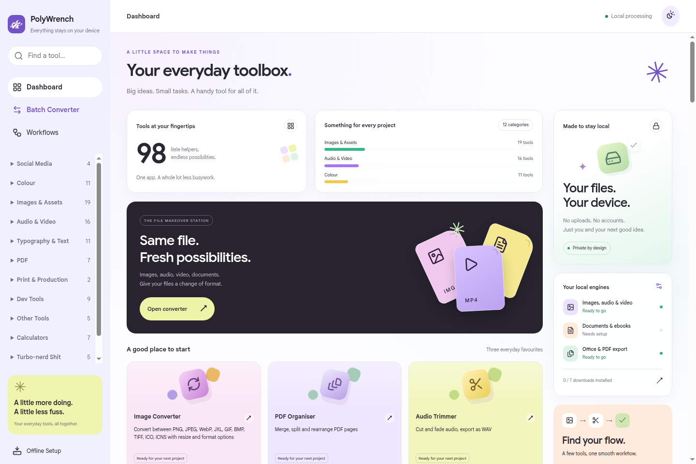
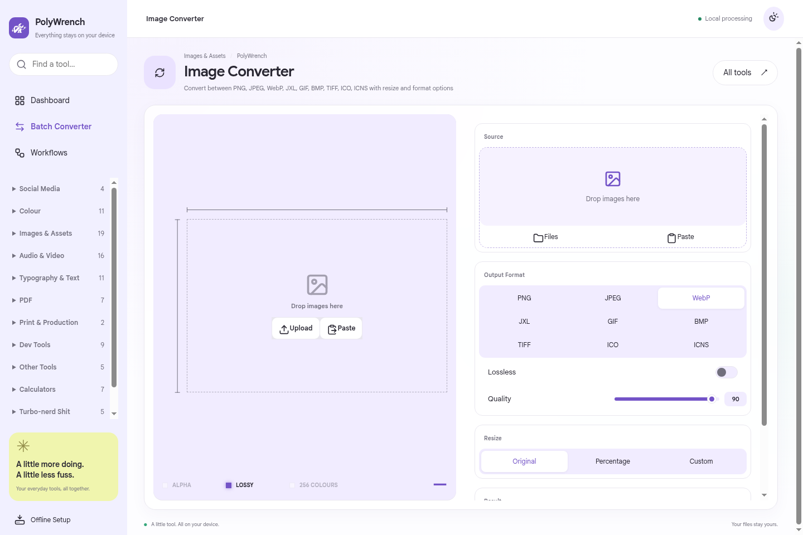

<p align="center">
  
</p>

<h1 align="center">PolyWrench</h1>
<p align="center"><strong>One desktop workspace for file conversion and everyday creative tools.</strong></p>
<p align="center">Linux · Windows · macOS · Local processing · Open source</p>

PolyWrench combines Delphi’s open-source toolkit with a new desktop interface and a native batch file converter. It runs in its own application window, with native file dialogs and local conversion engines. It does not require a browser, account, subscription or hosted service.

**Status:** initial implementation. See [verification and limitations](#verification-and-limitations) before distributing builds. Installer workflows are included; creating this repository does not itself publish release installers.



## Features

- **A colourful workspace:** a pastel dashboard with live engine-readiness widgets, quick tool cards, category navigation, search and light/dark themes.
- **Consistent tool screens:** rounded settings panels, clean controls, shared typography and individual tool headers.
- **A softer finish:** Peach & Teal colors, local Google Sans fonts, frosted surfaces and subtle entrance/hover motion, with reduced-motion and reduced-transparency support.
- **Batch conversion:** select or drop multiple files, choose an output format and folder, select standard/high quality, follow per-file status, cancel a batch and reveal completed outputs.
- **Preserved originals:** conversions create separate outputs. Existing filenames receive a numbered suffix instead of being overwritten.
- **Offline setup:** explicitly download conversion engines, the document tool’s WASM engine and speech/background-removal models. Downloads have pinned versions, expected sizes and SHA-256 verification. Interrupted setup can be retried.
- **Local processing:** renderer network requests are blocked in production. Downloads run only when requested in Offline Setup. External links open in your browser after confirmation.
- **Creative suites:** Image Studio, PDF Studio and workflows for chaining compatible tools.
- **100 tool, suite and workspace entries** from the pinned Delphi snapshot. The [complete inventory](docs/tool-inventory.json) is generated from the actual registry, with source components checked for existence.



### Included tool families

| Category | Examples |
| --- | --- |
| Images & assets | Convert/compress images, remove backgrounds, crop/mask/split/stitch, trace to SVG, strip metadata, generate favicons |
| Audio & video | Extract/normalize/trim audio, trim/mute video, video to GIF, frame extraction, subtitles, recording, waveforms |
| PDF & print | Merge/reorder/split, images to PDF, PDF to images, compression, numbering, rotate/crop, preflight, booklet/zine imposition |
| Colour | Pick/extract/generate palettes, colour conversion, gradients, harmonies, contrast and colour-blindness checks |
| Text & typography | Document conversion, Markdown editing, diff, word count, fonts/glyphs and typography calculations |
| Developer tools | JSON formatting, regex testing, JWT decoding, cron, UUIDs, HTTP status references and request composition |
| Generators & utilities | QR/barcodes, passwords, ciphers, text manipulation and social-media image tools |
| Calculators | Scientific, symbolic algebra, graphing, bases, encodings, units and time |
| Language tools | Braille, Morse, IPA, NATO phonetics and Shavian transliteration |
| Experiments | Recipe tables and unusual unit conversions |

## Install or update PolyWrench

Packaged applications do **not** need Node.js, npm, Git, Python or Rust. Download the package for your operating system and processor:

| Operating system | Package | GitHub Actions artifact |
| --- | --- | --- |
| Ubuntu, Debian, Linux Mint and other Debian-based systems, x86-64 | `.deb` | `PolyWrench-Linux-x64` |
| Other Linux distributions, x86-64 | `.AppImage` | `PolyWrench-Linux-x64` |
| Windows, x86-64 | `.exe` installer | `PolyWrench-Windows-x64` |
| macOS, Intel | `.dmg` | `PolyWrench-macOS-x64` |
| macOS, Apple Silicon (M-series) | `.dmg` | `PolyWrench-macOS-arm64` |

`x64`, `x86-64` and `amd64` refer to the same processor family. The current workflow does not produce Linux ARM or Windows ARM installers. On macOS, **Apple menu → About This Mac** identifies an Apple chip or Intel processor.

### Download an installer

- **Published releases:** open [Releases](https://github.com/aatish1321/PolyWrench/releases) and download the matching package from a published release's assets, when available.
- **Builds before publication:** open [Desktop checks and packages](https://github.com/aatish1321/PolyWrench/actions/workflows/desktop.yml), select a successful run for the version/commit you want, and download the matching artifact from the table above. Sign into GitHub to download workflow artifacts, then extract the downloaded ZIP to find the installer. Artifacts are temporary and can expire; see [GitHub's download instructions](https://docs.github.com/en/actions/how-tos/manage-workflow-runs/download-workflow-artifacts?tool=webui).
- **Built locally:** packages are in the project's `release/` directory; see [Build desktop packages](#build-desktop-packages).

The commands below use version **0.1.3**. Substitute the filename you downloaded for a later version. Quit PolyWrench completely before updating, including any open application windows.

### Ubuntu, Debian and Linux Mint

Open a terminal in the folder containing the `.deb`, then run:

```bash
sudo apt install ./PolyWrench-0.1.3-linux-amd64.deb
```

For a local build, run this from the project directory instead:

```bash
sudo apt install ./release/PolyWrench-0.1.3-linux-amd64.deb
```

The same command installs PolyWrench for the first time **or upgrades an existing installation when the package version is newer**. It does not create a second copy, and you do not need to uninstall first. Launch PolyWrench from your Applications menu after installation.

If you rebuilt a package **without changing its version**, force replacement of the installed files with `--reinstall`:

```bash
sudo apt install --reinstall ./PolyWrench-0.1.3-linux-amd64.deb
```

For example, upgrading **0.1.2 → 0.1.3** uses ordinary `apt install`; replacing an already installed **0.1.3** with a rebuilt **0.1.3** uses `--reinstall`. See the [APT reinstall option](https://manpages.ubuntu.com/manpages/jammy/man8/apt-get.8.html).

### Other Linux distributions: AppImage

Keep the `.AppImage` in a permanent folder, such as `~/Applications`. Open a terminal in that folder, make the file executable and run it:

```bash
chmod +x ./PolyWrench-0.1.3-linux-x86_64.AppImage
./PolyWrench-0.1.3-linux-x86_64.AppImage
```

Run it as your normal user. AppImage runs directly rather than installing through a package manager; application-menu integration depends on your desktop environment. If it reports missing FUSE support, follow the [official AppImage FUSE instructions](https://docs.appimage.org/user-guide/troubleshooting/fuse.html), or use the `.deb` on a Debian-based system.

To update, quit the old copy, download the newer AppImage, make it executable and launch it. Update any shortcut that points to the old filename. Keep the previous file until you have checked the new build, then remove the old AppImage if you no longer need it.

### Windows

1. Extract the downloaded artifact ZIP if applicable, then double-click the PolyWrench `.exe` installer.
2. Follow the setup wizard and choose the installation folder.
3. Launch PolyWrench from the Start menu or the shortcut created by setup.

To update, quit PolyWrench and run the newer installer using the same installation location. Uninstalling first is unnecessary. Unsigned builds may display an unknown-publisher warning; check that the installer came from this repository before proceeding.

### macOS: Intel and Apple Silicon

1. Download the `.dmg` matching your Mac: **x64 for Intel**, **arm64 for Apple Silicon**.
2. Open the disk image and drag **PolyWrench.app** into **Applications**.
3. Eject the disk image, then open PolyWrench from Applications.

To update, quit PolyWrench, open the newer matching DMG and drag the app into Applications again. Choose **Replace** when Finder asks about the existing copy.

Development builds are not signed/notarized. If macOS blocks an unverified developer, follow [Apple's instructions](https://support.apple.com/en-us/102445): after attempting to open the app, use **System Settings → Privacy & Security → Open Anyway** only if you trust the downloaded build.

### After installing or updating

- Open **Offline Setup** to install the engines/models needed for your tools; see [First launch and offline setup](#first-launch-and-offline-setup).
- Settings and downloaded packs are stored separately from the application. These update steps retain the existing user-data directory; avoid deleting it when replacing the app.
- Updates are manual: PolyWrench does not currently download or install application updates automatically.
- Editing or pulling source files does not update an installed application. Build and install a new package, or use [Run from source](#run-from-source) to preview a checkout.

Version 0.1.3 includes the Peach & Teal palette, Google Sans fonts bundled for offline use, frosted surfaces and animations. Reduced-motion and reduced-transparency preferences are respected.

## Run from source

You need **Node.js 24 LTS**, npm and Git. Python and Rust are not required. Building requires internet access to install npm dependencies; running installed tools is local.

```bash
git clone https://github.com/aatish1321/PolyWrench.git
cd PolyWrench
npm ci
npx install-electron --no
npm run build
npm run desktop
```

`install-electron` explicitly installs the Electron runtime. It is safe to run again if it is already installed. Native engine/model downloads happen separately inside the app.

For development with live reload:

```bash
npm run dev:desktop
```

This starts a local Vite development server and opens it in Electron. Production builds load packaged application files directly and require no server. The internal Ember module/package name remains `delphitools-v2` so upstream imports continue to work; the application and installers are named PolyWrench.

### System requirements

- **Linux:** x86-64 desktop with Electron’s GTK3/X11 or XWayland prerequisites. AppImage may require FUSE; alternatively use a deb package or unpacked build. Keep Chromium’s sandbox enabled for everyday use.
- **Windows:** x86-64 Windows supported by the pinned Electron release.
- **macOS:** Intel x86-64 or Apple Silicon. Microphone/screen recording requires macOS permissions.
- **AI tools:** enough disk space and memory for the selected model. The setup screen shows download sizes. Large Turbo transcription requires working WebGPU; Base/Small offer CPU fallback.

## First launch and offline setup

1. Open **Offline Setup** from the sidebar.
2. Download **FFmpeg** for batch image/audio/video conversion and **Pandoc** for batch document conversion. Existing installations on `PATH` are detected; you can select a different executable.
3. For office formats and PDF export, install [LibreOffice](https://www.libreoffice.org/download/download-libreoffice/) and select `libreoffice` or `soffice`. PolyWrench detects common Windows/macOS installation locations. LibreOffice is installed separately, not downloaded automatically by PolyWrench.
4. Download **Document Converter engine** to use the original document tool. This is separate from native Pandoc used by the batch converter.
5. Download only the subtitle models you need. Background removal requires a separate model download and acceptance of its license.
6. Once selected downloads show **Ready offline**, those features can run without internet access, including after restarting the app.

**Background-removal model terms:** the upstream BRIA RMBG-1.4 model has separate non-commercial-use terms; commercial use needs a commercial license. PolyWrench’s source-code license does not grant commercial rights to this model. Read the linked model license in Offline Setup before downloading it. Models are not included in this Git repository or installer.

App settings, selected engine paths and downloaded packs live in Electron’s platform-specific user-data folder for PolyWrench. Source files remain where you selected them; outputs go to the destination you choose. The batch queue is session-only and does not resume after closing the application.

## Converting files

1. Open **Batch Converter**.
2. Choose or drop files from one compatible family.
3. Pick a target shared by all files in the batch.
4. Choose an output folder and quality.
5. Click **Convert files**. Use **Show file** to reveal successful outputs.

Files run sequentially to avoid launching many heavy conversion processes at once. An error on one file does not discard other results. Cancelling stops the active conversion and cancels pending entries; completed files are retained. Temporary conversion files are cleaned up.

### Batch format support

| Input family | Available outputs | Engine |
| --- | --- | --- |
| Audio: MP3, WAV, FLAC, AAC, OGG, M4A, Opus, AIFF | Other listed audio formats | FFmpeg |
| Video: MP4, MKV, WebM, MOV, AVI, M4V | MP4, MKV, WebM, MOV; audio extraction; GIF | FFmpeg |
| Images: PNG, JPG/JPEG, WebP, AVIF, BMP, TIFF, GIF, ICO | Other listed image formats | FFmpeg |
| Markdown, HTML, LaTeX, EPUB, DOCX, ODT, TXT | Markdown, HTML, LaTeX, EPUB, DOCX, ODT, RTF, TXT | Pandoc |
| Word/text: DOC, DOCX, ODT, RTF, TXT | DOCX, ODT, RTF, TXT, PDF | LibreOffice |
| Presentations: PPT, PPTX, ODP | PPTX, ODP, PDF | LibreOffice |
| Spreadsheets: XLS, XLSX, ODS, CSV | XLSX, ODS, CSV, PDF | LibreOffice |

Only formats supported by the selected input family and an available engine are offered. Identical input/output extensions are omitted. Codec availability still depends on the FFmpeg build; unsupported codecs produce a per-file error. Complex document layout may change during conversion. TXT input passed to Pandoc is interpreted as Markdown. Image batches export the first frame of animated sources.

Use the specialized tools for additional formats/options, including JXL, ICNS, SVG optimization, PDF/image operations and SRT/VTT subtitle conversion. PDF-to-editable-Word and OCR are not included.

## Build desktop packages

```bash
# Unpacked application for the current OS
npm run pack

# Installers for the current OS
npm run dist:desktop
```

Output is written to `release/`:

- Linux x64: AppImage and deb.
- Windows x64: NSIS installer.
- macOS: DMG; build Intel and Apple Silicon separately with electron-builder’s `--x64` / `--arm64` flags.

Use the target operating system to build and test its packages. The GitHub Actions workflow performs the cross-platform matrix and uploads build artifacts. To create a release, push a version tag such as `v0.1.0`; it creates a **draft** GitHub release with installers. Review the draft and platform checks before publishing.

Code signing/notarization needs your own publisher credentials; no secrets belong in the repository. Without them, Windows/macOS may display unsigned-app warnings. Automatic application updates are not implemented.

## Tests and verification

```bash
npm run check          # Type checking, native tests and inventory generation
npm run build         # Production renderer bundle
npm run test:smoke    # Real Electron window: tool routes, preload, network/IPC checks
npm audit --omit=dev  # Packaged Node dependencies
```

On a Linux CI machine without a desktop, run `xvfb-run -a npm run test:smoke`. The smoke harness disables the Chromium sandbox only in its disposable test process; the application launcher does not disable it.

Native tests cover target validation, argument handling, cancellation, unique output names, real FFmpeg conversion when installed, failed-conversion cleanup, download checksums and interrupted downloads. GUI smoke checks render every inventoried route; these checks do not prove every possible input or setting works. Upstream tests and focused verification scripts remain available under `tests/` and `scripts/verify/`.

### Verification and limitations

- Build/GUI results from this development run are recorded in [the validation notes](docs/VALIDATION.md).
- Camera/microphone/screen recording requires real hardware and OS permission checks. System/tab audio capture is not implemented in the desktop picker; microphone mixing remains available.
- Large models and conversions can take substantial memory/time. A download requires connectivity and enough disk space; there is no cloud fallback.
- Offline setup cancellation discards the incomplete pack; retry downloads it again. Existing completed packs are retained.
- Some upstream promotional artwork and a font were excluded because redistribution permission was not available. Tool processing is retained.
- Runtime Node dependency audit and renderer dependency review are different checks: bundled renderer libraries originate from the larger upstream dependency tree. Do not interpret a clean `--omit=dev` audit as proof that the entire renderer is vulnerability-free.

## Project layout

```text
app/                  Reused Delphi tools and redesigned desktop interface
public/               Packaged WASM, fonts, dictionaries and PolyWrench logo
desktop/              Electron main/preload, native conversion and asset setup
scripts/              Build, inventory, asset-lock and smoke-test commands
docs/                 Tool inventory, licenses and verification notes
.github/workflows/    Desktop CI and draft release packaging
```

To update offline assets, review the versions, model terms and upstream sources in `scripts/lock-assets.mjs`, run `npm run assets:lock`, inspect the resulting `desktop/assets.lock.json`, then test installation/offline use. End users never generate or trust a download manifest supplied from the network.

## Contributing

Open an issue with your operating system, source/target formats, engine version and the displayed error. Avoid attaching private files; a small non-sensitive reproduction is best. Keep pull requests focused and include the relevant tests. Do not commit engine binaries, models, user files, downloaded packs, credentials or build outputs.

## License and credits

PolyWrench’s new code is **AGPL-3.0-or-later**, with the full license in [LICENSE](LICENSE). It builds on [Delphi Tools](https://github.com/1612elphi/delphitools), created by Ruby Morgan Voigt and contributors, pinned at `ce5e32786a0af4f04eb72f36370f3dd5ec6ddf39`. Original code retains its [0-BSD license and third-party exceptions](UPSTREAM-LICENSE).

See [third-party notices](docs/THIRD-PARTY.md), [upstream acknowledgements](ACKNOWLEDGEMENTS.md) and the license files shipped alongside runtime assets. Models, fonts, codecs and external conversion engines retain their own terms. PolyWrench is an independent derivative project, not an official Delphi release.
